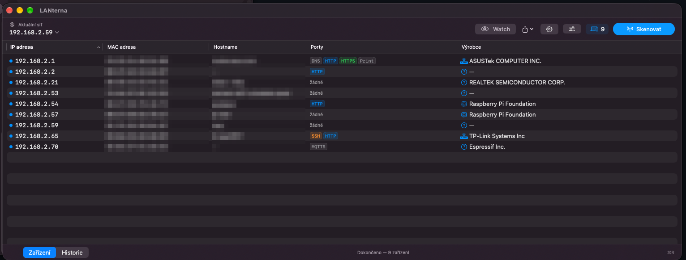

# LANterna

**Rychlý a přehledný skener lokální sítě pro macOS.** Za pár sekund ukáže, co všechno je ve vaší síti: počítače, telefony, tiskárny, kamery, router i chytrá zařízení.

## Co umí

- **Najde všechna zařízení v síti** (podsíť /24 nebo vlastní rozsah IP, i přes VPN).
- **Ukáže MAC adresu a výrobce** zařízení, takže poznáte, co je co.
- **Zjistí název zařízení** (DNS, mDNS/Bonjour, NetBIOS).
- **Zkontroluje otevřené porty** (asi 70 běžných služeb: web, SSH, SMB, tisk, MQTT a další).
- **IPv6**, detail zařízení a přehled sítě.
- **Historie skenů a hlídání změn** – upozorní, když se v síti objeví nové zařízení.
- **Export** do CSV a JSON, **Wake-on-LAN**.
- **Čeština a angličtina.**
- **Pamatuje si** velikost okna, záložku a řazení tabulky.
- **Samo se aktualizuje** – nové verze si hlídá a nainstaluje je po potvrzení (Nastavení → Aktualizace). Každé vydání je podepsané a podpis se před instalací ověří.

## Instalace

1. Stáhněte `LANterna_x.y.z.zip` z [nejnovějšího vydání](https://github.com/Spock89/lanterna-releases/releases/latest).
2. Rozbalte ho a přesuňte **LANterna.app** do složky Aplikace.
3. Při prvním spuštění klikněte na aplikaci pravým tlačítkem → **Otevřít** (aplikace není podepsaná u Applu).
4. Povolte přístup k **místní síti**, když se macOS zeptá. Bez něj macOS skrývá MAC adresy.

**Požadavky:** macOS 14 Sonoma nebo novější, Mac s Intelem i Apple Silicon.

## Soukromí

LANterna skenuje jen vaši lokální síť. Nic neposílá na žádný server kromě dotazu na výrobce podle prefixu MAC adresy a kontroly nové verze na GitHubu.
